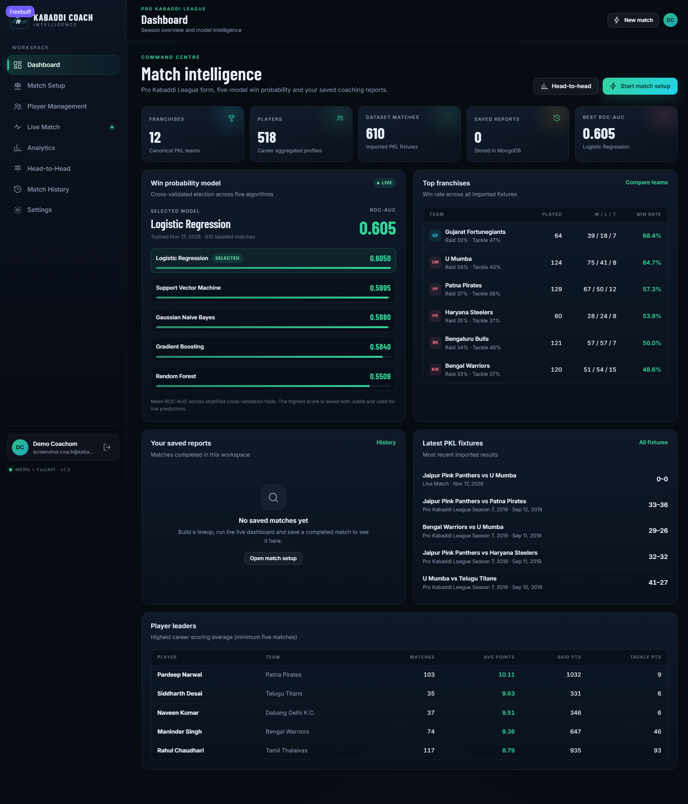
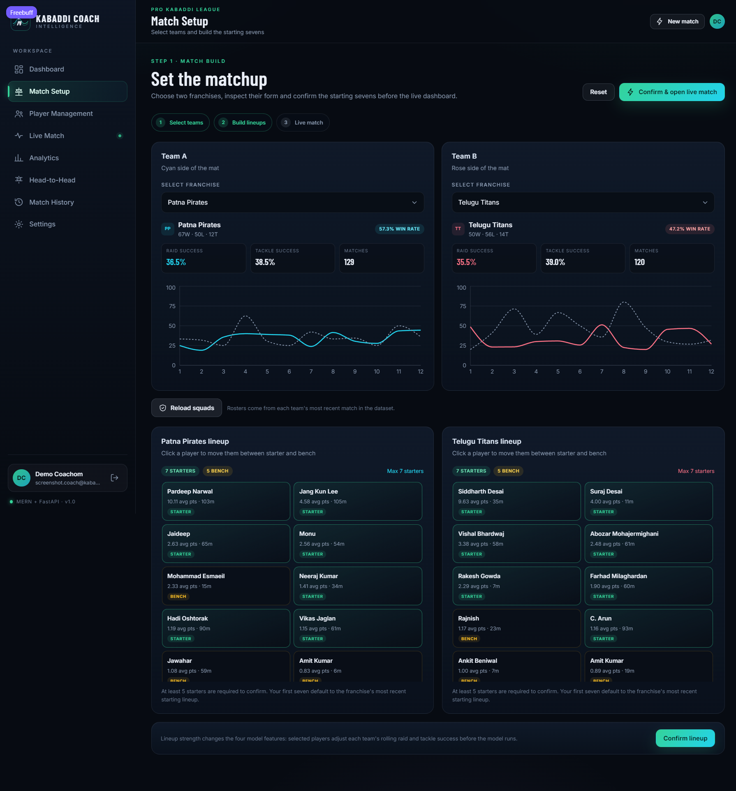
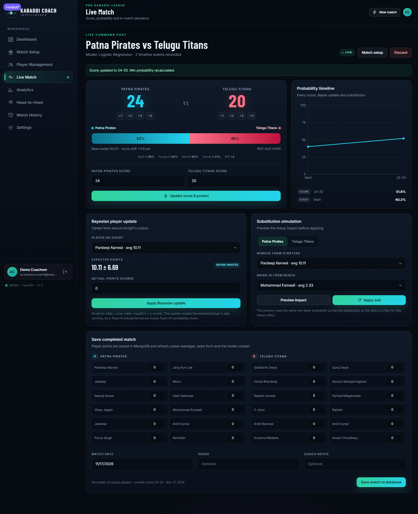
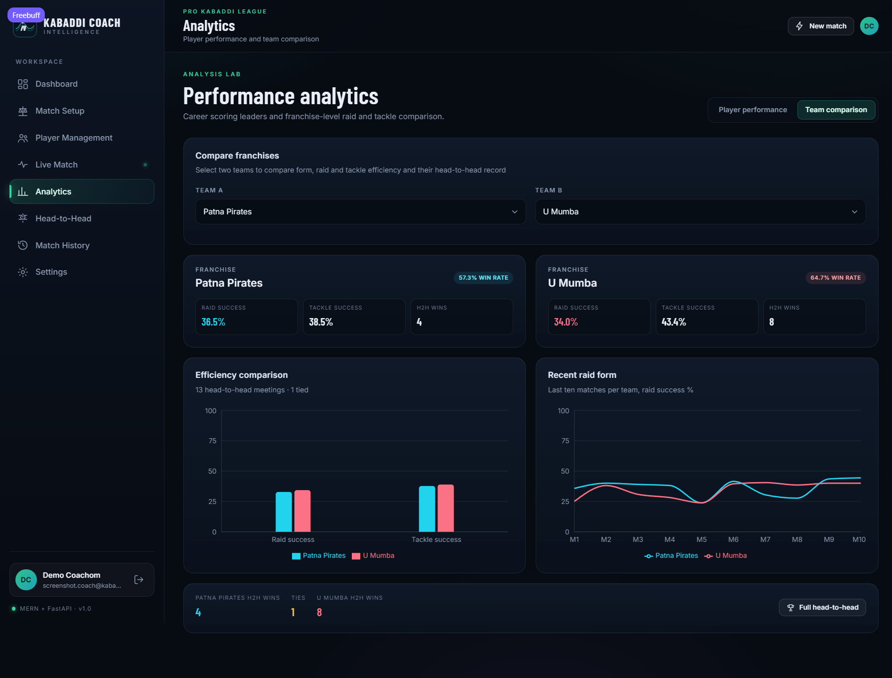

# Kabaddi Coach Intelligence

A full-stack coaching dashboard for Pro Kabaddi League match analysis. It turns the original
`Kabaddi_Coach_Dashboard_v10.ipynb` notebook into a MERN application with a separate Python
machine-learning service.

- **React + Vite** coach interface (10 screens, dark sports-analytics design)
- **Express + MongoDB** API, JWT authentication and persistence
- **FastAPI + scikit-learn** service for win probability, Bayesian updates and substitutions
- **Real PKL data** — 610 matches, 12 franchises, 518 players, 14,887 player appearances

The original notebook is kept unchanged at `Kabaddi_Coach_Dashboard_v10.ipynb` as the reference
implementation.

---

## Screenshots

| Dashboard | Match setup |
| --- | --- |
|  |  |

| Live match | Analytics |
| --- | --- |
|  |  |

| Head-to-head | Player management |
| --- | --- |
|  |  |

> Screenshots were captured from the running app against the imported dataset.

---

## Features

**Authentication** — register/sign in with bcrypt-hashed passwords and signed JWTs. Every
data route requires a token; each coach only sees their own saved matches and live session.

**Dashboard** — franchise/player/dataset counters, the cross-validated model leaderboard,
top franchises by win rate, saved reports, recent fixtures and career scoring leaders.

**Match Setup** — choose two franchises, inspect win rate, raid/tackle success and a 12-match
form chart, load the latest 12-man squads, and move players between starter and bench. Lineups
require at least five starters and cannot reuse the same franchise on both sides.

**Live Match** — score controls, a live win-probability gauge and timeline, model inputs,
Bayesian player updates, substitution preview/apply, and save-to-history. The live session is
persisted per user, so a refresh does not lose the match.

**Analytics** — player performance trends, team comparison and head-to-head history built from
imported results.

**Match History / Report** — paginated saved matches, detail view, CSV and JSON report download.

**Player Management** — search, team/role filters, sorting, pagination, player detail and recent
form.

**Settings** — account details, dataset/model status and API health.

---

## Architecture

```
┌────────────────────┐        /api (Vite proxy)        ┌────────────────────┐
│ React + Vite       │ ─────────────────────────────▶ │ Express API        │
│ localhost:5173     │ ◀───────────────────────────── │ localhost:5000     │
└────────────────────┘            JSON + JWT           └─────────┬──────────┘
                                                                  │
                                      ┌───────────────────────────┼──────────────────────┐
                                      │                           │                      │
                                      ▼                           ▼                      ▼
                             ┌──────────────────┐       ┌──────────────────┐   ┌──────────────────┐
                             │ MongoDB          │       │ FastAPI ML       │   │ PKL CSV dataset  │
                             │ kabaddi_coach    │       │ localhost:8000   │   │ dataset/*.csv    │
                             │ users, matches,  │       │ model.joblib     │   │ imported by      │
                             │ live sessions    │       │ metadata.json    │   │ server/scripts   │
                             └──────────────────┘       └──────────────────┘   └──────────────────┘
```

- MongoDB owns application data (users, saved matches, per-user live sessions).
- The ML service is **stateless for prediction**: Express supplies team form and player `mu`
  values from MongoDB, and the service performs model scoring, the score shift, the Bayesian
  update and substitution simulation.
- The browser never talks to FastAPI directly.

---

## Tech stack

| Layer | Technology |
| --- | --- |
| Frontend | React 18, Vite 5, React Router 6, Recharts, Axios |
| Backend | Node.js 18+, Express 4, Mongoose 8, JWT, bcryptjs, Zod, morgan |
| ML service | Python 3.10+, FastAPI, scikit-learn, pandas, NumPy, Joblib |
| Database | MongoDB (local) |

No Docker is required. The project is configured for Windows-local development and also runs on
macOS/Linux.

---

## Repository layout

```
.
├── Kabaddi_Coach_Dashboard_v10.ipynb   # original notebook (reference, untouched)
├── dataset/                            # PKL CSV exports + data notes
├── docs/screenshots/                   # screenshots used in this README
├── client/                             # React + Vite frontend
│   ├── src/pages/                      # dashboard, setup, live, analytics, ...
│   ├── src/services/kabaddi.js         # API client
│   └── src/context/AuthContext.jsx
├── server/                             # Express API
│   ├── models/                         # Mongoose schemas
│   ├── controllers/ routes/ middleware/
│   ├── services/                       # analytics, live sessions, ML client, reports
│   └── scripts/importData.js           # idempotent CSV → MongoDB importer
│       scripts/e2eCheck.js             # 30-check API end-to-end script
└── ml-service/
    ├── app/                            # config, preprocessing, train, predict, bayesian
    └── artifacts/                      # model.joblib + model_metadata.json (generated)
```

---

## Dataset

Place these files in `dataset/`:

- `PKL_matches.csv` — fixtures and results
- `PKL_teams.csv` — per-team per-match stats
- `PKL_players.csv` — player profiles
- `PKL_events.csv` — raw event export (kept for completeness; the notebook and this app do not
  use it as a model feature)

The importer reads the four CSVs, canonicalises franchise names (for example
`Dabang Delhi` → `Dabang Delhi K.C.`), and writes teams, team-match stats, players,
player-match stats and matches into MongoDB. Re-running it is idempotent; `--reset` clears the
imported collections first.

### Labels

Win labels come **only** from `PKL_matches.result`:

- `<team> beat <team>` → Team A win (`winA = 1`) when Team A is the winner.
- Tied/drawn results → `winA = 0`, matching the notebook's binary target.
- No random labels are generated anywhere. Matches that cannot be resolved are reported, never
  guessed.

The imported dataset contains 546 decisive results, 59 ties and 5 matches with an unknown result.
There are no unmapped winners. Those 64 non-decisive rows are trained as "Team A did not win",
which is the notebook's original label policy.

---

## Machine learning

### Features

Exactly the notebook's four features:

```
raid_success_A, tackle_success_A, raid_success_B, tackle_success_B
```

Team form is the mean of each team's previous five matches (current match excluded), taken from
`PKL_teams.csv` raid/tackle success. Selected-player `mu` values adjust each team's form before
scoring.

### Candidates and selection

Five algorithms are trained and compared with 5-fold stratified cross-validation (shuffled,
`random_state=42`, ROC-AUC). The highest mean ROC-AUC is saved with Joblib and used for live
predictions.

| Model | Mean CV ROC-AUC |
| --- | --- |
| **Logistic Regression (selected)** | **0.6050** |
| Support Vector Machine (RBF) | 0.5995 |
| Gaussian Naive Bayes | 0.5980 |
| Gradient Boosting | 0.5840 |
| Random Forest | 0.5509 |

ROC-AUC around 0.60 reflects how hard pre-match kabaddi prediction is from four form features;
the app reports the measured value rather than inventing a higher one.

### Live probability

The model produces a base probability from the four features. A score-margin shift is then
applied through a sigmoid centred at a tied score, and the result is clipped to a safe range.
Lineup changes affect the same four features, so a substitution preview compares final
probabilities on both sides.

### Notebook corrections (documented, not hidden)

1. **Rolling window boundary bug** — the notebook chained `groupby().shift().rolling()`, so the
   first rows of each team's history leaked across team boundaries. The service rolls strictly
   within each team.
2. **Bayesian Team B bug** — the notebook always moved Team A's prior. The service flips the
   prior correctly when a Team B player is updated.
3. **Substitution preview** — the notebook compared a score-shifted live probability with an
   unshifted model probability. The service compares like-for-like final probabilities.
4. **Random-label fallback removed** — unresolved results are reported as data issues instead of
   being filled with random targets.

Details are also written into `ml-service/artifacts/model_metadata.json`.

---

## Prerequisites

- Node.js 18 or newer
- Python 3.10 or newer (tested on 3.12)
- MongoDB running locally on `127.0.0.1:27017`
- The four PKL CSVs in `dataset/`

Python packages are installed in a virtual environment. No cloud services, API keys or Docker are
needed.

---

## Setup

Run each service in its own terminal.

### 1. MongoDB

Start MongoDB locally (Windows service, `mongod`, or MongoDB Compass). The default connection is:

```
mongodb://127.0.0.1:27017/kabaddi_coach
```

### 2. ML service

```bash
cd ml-service
python -m venv .venv
```

Windows:

```powershell
.venv\Scripts\activate
```

macOS/Linux:

```bash
source .venv/bin/activate
```

Then install, train and serve:

```bash
pip install -r requirements.txt
python -m app.train
uvicorn app.main:app --reload --port 8000
```

`python -m app.train` prints the five CV scores, writes `artifacts/model.joblib` and
`artifacts/model_metadata.json`, and exits. Start `uvicorn` afterwards.

Verify: <http://127.0.0.1:8000/health> — `modelReady` should be `true`. Interactive API docs are
at <http://127.0.0.1:8000/docs>.

### 3. Backend

```bash
cd server
npm install
cp .env.example .env
```

On Windows PowerShell use `Copy-Item .env.example .env`. Then replace `JWT_SECRET` with a long
random value, for example:

```bash
node -e "console.log(require('crypto').randomBytes(48).toString('hex'))"
```

Import the dataset and start the API:

```bash
npm run import
npm run dev
```

Use `npm run import:reset` to clear previously imported teams/players/matches before re-importing.
Verify: <http://127.0.0.1:5000/api/health>.

### 4. Frontend

```bash
cd client
npm install
cp .env.example .env
npm run dev
```

Open <http://localhost:5173>, create an account and sign in. The Vite dev proxy forwards `/api` to
`http://127.0.0.1:5000`.

### Environment variables

`server/.env`

| Variable | Default | Purpose |
| --- | --- | --- |
| `PORT` | `5000` | Express port |
| `MONGODB_URI` | `mongodb://127.0.0.1:27017/kabaddi_coach` | Database |
| `JWT_SECRET` | — | Signing key (**required**) |
| `JWT_EXPIRES_IN` | `7d` | Token lifetime |
| `ML_SERVICE_URL` | `http://127.0.0.1:8000` | FastAPI base URL |
| `CLIENT_ORIGIN` | `http://localhost:5173` | Allowed CORS origin |

`client/.env`

| Variable | Default | Purpose |
| --- | --- | --- |
| `VITE_API_URL` | `/api` | API base; keep `/api` for the dev proxy |

`ml-service/.env` (optional)

| Variable | Default | Purpose |
| --- | --- | --- |
| `PKL_DATA_DIR` | `../dataset` | CSV location |
| `ML_ARTIFACTS_DIR` | `./artifacts` | Model output |
| `ML_ALLOWED_ORIGINS` | localhost origins | CORS allow-list |
| `ML_TRAIN_TOKEN` | empty | If set, `POST /train` requires `x-train-token` |

`.env` files are git-ignored; only `.env.example` templates are committed. Never commit real
secrets.

---

## API reference

All routes are prefixed with `/api`. Except for `/health`, `/auth/register` and `/auth/login`,
every route requires `Authorization: Bearer <token>`.

| Group | Endpoints |
| --- | --- |
| Auth | `POST /auth/register`, `POST /auth/login`, `GET /auth/me` |
| Teams | `GET /teams`, `GET /teams/compare`, `GET /teams/:teamId`, `GET /teams/:teamId/stats`, `GET /teams/:teamId/roster` |
| Players | `GET /players`, `GET /players/team/:teamId`, `GET /players/:playerId` |
| Matches | `GET /matches`, `GET /matches/history`, `POST /matches`, `GET /matches/:id`, `PUT /matches/:id`, `GET /matches/:id/report?format=csv\|json` |
| Live | `GET/POST/DELETE /live/session`, `PATCH /live/score`, `POST /live/bayesian`, `POST /live/substitution/preview`, `POST /live/substitution` |
| Analytics | `GET /analytics/overview`, `GET /analytics/head-to-head`, `GET /analytics/player-performance` |
| ML status | `GET /ml/status`, `GET /ml/model-info` |

The ML service exposes `GET /health`, `GET /model-info`, `POST /predict`,
`POST /bayesian-update`, `POST /substitution-impact` and `POST /train`.

---

## Verification

The repository includes an end-to-end API script that exercises authentication, teams, rosters,
live scoring, Bayesian updates, substitutions, saving, history, reports, analytics and the ML
proxy. Run it against a scratch database, not your working database:

```bash
# terminal A
cd server
PORT=5001 MONGODB_URI=mongodb://127.0.0.1:27017/kabaddi_coach_test node server.js

# terminal B
cd server
API_BASE=http://127.0.0.1:5001/api node scripts/e2eCheck.js
```

The current implementation passes all 30 checks, including:

- 12 teams and full 12-player squads
- live probability rising from 44.9% to 69.9% as the score moves
- Bayesian updates raising Team A and lowering it for a Team B player
- a saved match (`matchId 1774` on the scratch DB) appearing in history
- CSV report download, H2H (14 meetings) and dashboard overview

The client production build is verified with:

```bash
cd client
npm run build
```

There is no automated browser test suite; UI screens were verified manually against the running
app while capturing the screenshots above.

---

## Notes and limitations

- **Model quality is modest by design.** Four pre-match form features yield CV ROC-AUC ≈ 0.60.
  Treat live probabilities as decision support, not certainty.
- **Ties are not a third class.** The notebook used a binary `winA` target; ties and 5
  unknown-result matches are trained as Team A not winning, and this is reported in model
  metadata.
- **Rosters are latest-match based.** A team's squad comes from its most recent imported match,
  which is the closest available proxy for the current 12-man roster.
- **`PKL_events.csv` is not used.** No notebook feature consumes it; the importer intentionally
  omits it. This avoids inventing event-level features that the original model never had.
- **One live session per coach.** Sessions are stored per user and replaced when a new match is
  confirmed.
- **Local development setup.** JWTs are signed with a local secret; use HTTPS, a managed MongoDB
  and a secret manager before exposing this publicly.
- **The pre-existing 11/17/2026 "Live Match" row** in `PKL_matches.csv` (a 0–0 record saved by the
  notebook itself) is imported as-is; it is visible in fixtures as dataset history.

---

## Data credit

Pro Kabaddi League match, team and player data comes from the CSV exports supplied with the
original notebook. This project is an educational analytics tool and is not affiliated with the
Pro Kabaddi League.
